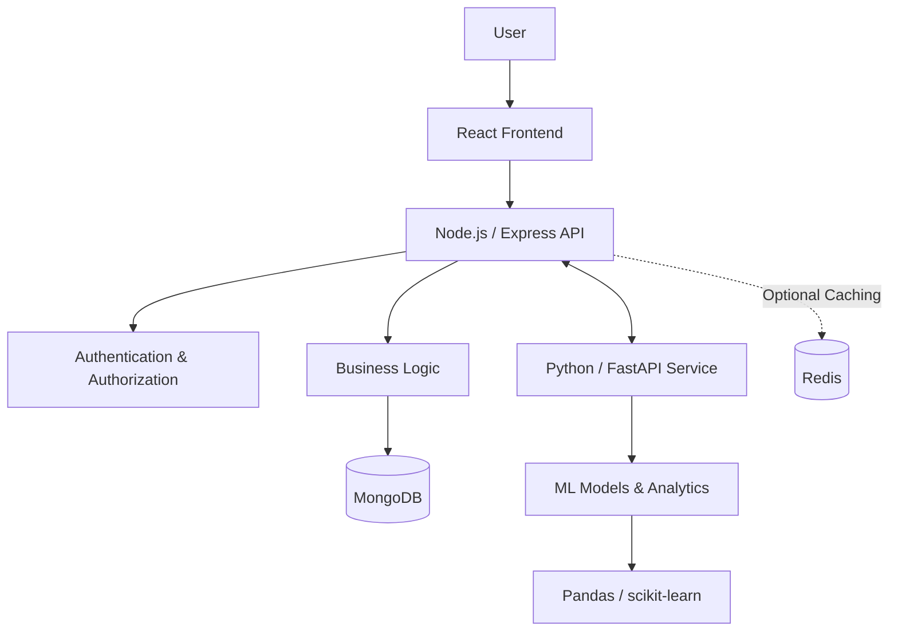

# AI-Powered Expense Tracker & Budget Planner

An intelligent personal finance application designed to help users track income and expenses, manage budgets, monitor savings goals, and gain meaningful insights into their spending habits through data analytics and machine learning.

**Project Status:** 🚧 In Development

---

## 📌 Overview

Managing personal finances involves more than recording transactions. Understanding spending patterns, maintaining budgets, achieving savings goals, and making informed financial decisions require clear insights into financial activity.

The **AI-Powered Expense Tracker & Budget Planner** aims to address these challenges through a full-stack web application that combines conventional financial management features with data analytics and Python-based AI/ML capabilities.

The application will allow users to manage their financial records, visualize spending patterns, compare actual expenses against planned budgets, and receive personalized, data-driven budgeting suggestions.

The project also serves as a collaborative learning initiative focused on full-stack web development, backend architecture, API integration, data analysis, and practical machine learning.

## ✨ Key Features

The following features represent the planned scope of the application. Their implementation status will evolve as development progresses.

### 💰 Transaction Management
- Record, view, update, and delete income and expense transactions.
- Organize transactions by category, date, and transaction type.
- Search and filter transactions using relevant criteria.
- Review transaction history and financial totals for selected periods.
- Support user corrections for automatically suggested transaction categories.

### 📊 Budget Planning
- Create monthly budgets and category-specific spending limits.
- Compare planned budgets against actual expenses.
- Monitor remaining budgets and spending percentages.
- Identify budget overruns and approaching spending limits.
- Generate suggested budgets based on historical spending patterns.

### 🎯 Savings Goals
- Establish savings goals with target amounts and dates.
- Track progress toward financial targets.
- Evaluate savings goals against available income and typical expenses.
- Receive suggestions when a target appears difficult to achieve based on available financial data.

### 📈 Financial Dashboard
- View income, expenses, and net balance.
- Analyze spending distribution across categories.
- Explore weekly and monthly spending trends.
- Compare budget allocations with actual spending.
- Monitor recent transactions and relevant budget alerts.

### 🤖 AI-Powered Financial Insights
- Automatically suggest categories for transactions.
- Identify unusual transactions and changes in spending patterns.
- Generate personalized budget recommendations.
- Analyze historical financial activity to identify potential areas for savings.
- Provide data-backed explanations of spending patterns.

### 💬 Financial Assistant
- Ask questions about recorded financial activity.
- Compare spending across different periods.
- Identify the highest-spending categories.
- Evaluate progress toward savings goals.
- Request budget suggestions based on available transaction history.

The assistant is intended to provide explanations grounded in actual application data rather than inventing transactions, balances, or financial patterns.

---

## 🛠️ Technology Stack

The project follows a MERN-style architecture with a separate Python-based AI/ML service.

| Component | Technologies | Responsibility |
|---|---|---|
| Frontend | React, JavaScript/TypeScript, HTML, CSS | User interface and application interactions |
| UI Styling | Tailwind CSS | Responsive and consistent interface styling |
| State Management | React State, Context API, Redux if needed | Managing application state |
| Data Visualization | Chart.js | Financial charts and spending analytics |
| Main Backend | Node.js, Express.js | REST APIs, authentication, authorization, and business logic |
| Database | MongoDB *(proposed)* | Persistent storage of users and financial records |
| AI/ML Service | Python, FastAPI | Exposing AI, ML, and analytics capabilities |
| Data Processing | Pandas | Preparing and processing transaction data |
| Machine Learning | scikit-learn | Initial classification and anomaly-detection models |
| Deep Learning | PyTorch *(optional)* | Potential future ML capabilities when justified |
| Caching | Redis *(optional)* | Caching or temporary state where appropriate |
| Validation | Pydantic | Validating AI-service requests and responses |
| Version Control | Git and GitHub | Source control and team collaboration |

**Note:** The technology stack is proposed rather than completely finalized. Optional technologies will be introduced only when they solve an identified problem.

---

## 🏗️ System Architecture

The application separates the frontend, main backend, database, and AI/ML service into distinct responsibilities.



### Component Responsibilities

**React Frontend**
- Provides transaction forms, dashboards, charts, and assistant interfaces.
- Handles user interactions and client-side validation.
- Communicates with the main backend through API requests.

**Node.js / Express Backend**
- Manages authentication and authorization.
- Validates incoming requests and enforces data ownership.
- Handles transaction, budget, and savings-goal operations.
- Performs financial calculations and data aggregation where appropriate.
- Coordinates requests to the AI/ML service.

**MongoDB**
- Stores user accounts, transactions, budgets, savings goals, and other required application data.
- Serves as the primary persistent data store if MongoDB is confirmed.

**Python / FastAPI Service**
- Exposes dedicated endpoints for AI/ML operations.
- Validates requests using Pydantic.
- Processes transaction data and executes supported models.
- Returns structured predictions, analytics, and recommendations.

**Redis**
- May be introduced for caching or temporary state when a clear use case exists.
- Will not replace the primary database for persistent financial records.

---

## 🔄 Example: AI-Powered Expense Categorization

A typical transaction categorization workflow will follow these steps:

1. The user enters an expense through the React frontend.
2. The main backend authenticates the user and validates the transaction.
3. The backend processes or saves the transaction according to the agreed workflow.
4. The backend sends the necessary transaction information to the FastAPI service.
5. The AI service predicts a likely category and returns a structured response.
6. The main backend validates the response and returns the result to the frontend.
7. The user can accept or correct the suggested category.

The implementation will account for uncertain predictions and AI-service failures so that the core expense-tracking functionality remains usable.

---

## 🧠 AI & Machine Learning

AI is intended to enhance the application's financial management capabilities without making the system unnecessarily complex.

### Planned Capabilities

| Capability | Approach |
|---|---|
| Expense Categorization | Begin with manual categories and rules, then evaluate a scikit-learn classifier |
| Anomaly Detection | Start with transparent statistical rules before considering more complex models |
| Budget Recommendations | Use historical spending, income, category averages, and savings targets |
| Financial Analytics | Aggregate transactions by date, period, and category |
| Financial Assistant | Answer questions using authorized application data and deterministic calculations |

### Model Evaluation

Machine learning features will be evaluated using appropriate methods rather than assumed to be accurate.

Depending on the feature and available dataset, evaluation may include:

- Precision, recall, and F1-score for classification.
- Confusion matrices to understand classification errors.
- Review of flagged transactions for anomaly detection.
- Comparisons against simple baselines for budget recommendations.
- Tests for financial constraints, missing data, and edge cases.

Predictions and recommendations should communicate their assumptions and limitations.

### Development Philosophy

The project follows an incremental approach:

1. Establish reliable core financial functionality.
2. Implement transparent calculations and rule-based solutions.
3. Introduce an initial ML capability.
4. Evaluate its performance using suitable data.
5. Expand to additional AI features only when justified.

Advanced techniques such as retrieval-augmented generation (RAG), orchestration, scheduled predictions, and deep learning are optional future enhancements rather than mandatory MVP requirements.

---

## 🚀 Getting Started

The project is currently in its planning and initial development stage. The following instructions describe the intended local development workflow; exact commands and environment variables should be finalized alongside the implementation.

### Prerequisites

Install the tools required for the components you intend to run:

- **Git** — version control.
- **Node.js and npm** — frontend and main backend development.
- **Python** — AI/ML service development.
- **MongoDB** — database, if confirmed as the project's database.
- **Redis** — only if an implemented feature requires it.
- **Visual Studio Code or PyCharm** — recommended development environments.

Use compatible, supported versions of these tools and document the versions adopted by the team.

### 1. Clone the Repository

```bash
git clone https://github.com/TalhaAhmad-Codes/Finlyt
cd https://github.com/TalhaAhmad-Codes/Finlyt
```

Replace the placeholders with the actual repository URL and directory name.

### 2. Configure the Frontend

Navigate to the frontend directory:

```bash
cd frontend
npm install
```

Create the required environment configuration using the project's documented variable names and the provided example configuration, if available.

Start the development server using the script defined in `package.json`. For a typical Vite application, this may be:

```bash
npm run dev
```

### 3. Configure the Main Backend

Navigate to the backend directory:

```bash
cd backend
npm install
```

Configure the required environment variables, including database connection details and authentication secrets.

Start the backend using the script defined in its `package.json`. For example, if a development script is configured:

```bash
npm run dev
```

### 4. Configure the AI/ML Service

Navigate to the Python service directory:

```bash
cd ai-service
```

Create and activate a virtual environment.

**Windows — PowerShell**

```powershell
python -m venv .venv
.\.venv\Scripts\Activate.ps1
```

**Linux / macOS**

```bash
python3 -m venv .venv
source .venv/bin/activate
```

Install dependencies from the project's dependency file:

```bash
pip install -r requirements.txt
```

Start the FastAPI application using its actual module path and configured entry point. For example, if the application is exposed as `app.main:app`:

```bash
uvicorn app.main:app --reload
```

The module path above is illustrative; use the entry point defined by the implementation.

### 5. Verify the Setup

Once the required components are configured:

1. Confirm that the database is accessible.
2. Start the AI/ML service.
3. Start the main backend.
4. Start the frontend.
5. Verify the documented API endpoints and service connectivity.
6. Test the initial end-to-end workflow.

For reproducible setup, the team should maintain an example environment file, dependency manifests, and setup instructions as the implementation evolves.

---

## 🔐 Security & Privacy

Financial records require careful handling. Security and privacy are core design considerations rather than optional enhancements.

The application is intended to follow these principles:

- Hash passwords using an appropriate password-hashing algorithm.
- Verify authentication tokens correctly and enforce authorization on the server.
- Ensure users can access only their own financial records.
- Keep secrets and credentials out of source control.
- Validate incoming data at appropriate boundaries.
- Avoid logging passwords, tokens, and unnecessary financial details.
- Send only the data required for an AI/ML operation to the Python service.
- Handle missing, malformed, or contradictory financial data explicitly.
- Use synthetic data for development and demonstrations wherever possible.
- Evaluate privacy, cost, and data-retention implications before integrating an external LLM provider.

### Financial Disclaimer

This application is designed for personal budgeting, expense tracking, and financial awareness.

It is not a banking platform, investment adviser, tax system, or substitute for professional financial advice. AI-generated insights are informational suggestions, not guaranteed outcomes or definitive judgments about a user's spending.

An unusual transaction should be treated as a potential anomaly for review, not automatically classified as fraud or waste.

---

## 🧪 Testing Strategy

Testing will focus on financial correctness, access control, and reliable communication between application components.

Planned areas include:

- Transaction validation and CRUD operations.
- Date-range filtering and category-based queries.
- Accuracy of income, expense, balance, and savings calculations.
- Budget limits and savings-goal progress.
- Authentication and user-level authorization.
- AI-service request and response validation.
- Model predictions and uncertain results.
- Missing data, invalid inputs, and edge cases.
- Graceful handling of database and AI-service failures.

The goal is to keep the core application dependable even when an optional AI feature is unavailable.

---

## 🗺️ Development Roadmap

Development will prioritize a working financial management application before advanced AI features.

### Phase 1 — Foundation
- Confirm the MVP and project structure.
- Finalize the database and initial data models.
- Establish environment configuration and coding conventions.
- Define API contracts and repository workflows.

### Phase 2 — Core Application
- Implement registration, authentication, and authorization.
- Build transaction management.
- Add transaction categories, filtering, and validation.
- Develop basic dashboard calculations.
- Test core business logic and access control.

### Phase 3 — Budgeting & Savings
- Implement monthly budgets and category limits.
- Add savings goals and progress tracking.
- Introduce budget-versus-actual analytics.
- Build dashboard visualizations.

### Phase 4 — AI/ML Integration
- Establish the FastAPI service.
- Define the Node.js-to-Python API contract.
- Implement the first useful AI capability.
- Test predictions, invalid inputs, and service failures.

### Phase 5 — Insights & Refinement
- Add anomaly detection where time and data permit.
- Develop a data-backed financial assistant.
- Improve testing, accessibility, error handling, and responsiveness.
- Finalize setup documentation and demonstration data.

**Prioritization:** Correct financial calculations, secure data access, and reliable core workflows take precedence over advanced AI features.

---

## 🤝 Collaboration

This project is being developed collaboratively, with an emphasis on shared learning and maintainable implementation.

The development workflow aims to include:

- Feature-focused tasks and clearly defined acceptance criteria.
- Small, reviewable pull requests.
- Consistent API contracts across services.
- Code reviews and collaborative debugging.
- Documentation of important architectural decisions.
- Shared understanding of the technologies used across the stack.

Contributions should be tested and understood before merging rather than accepted without review.

---

## 📂 Project Structure

The exact repository structure will be documented once the implementation is established. A possible organization is:

```text
AI-Powered-Expense-Tracker/
│
├── frontend/                  # React application
│   ├── public/
│   ├── src/
│   └── package.json
│
├── backend/                   # Node.js / Express API
│   ├── src/
│   └── package.json
│
├── ai-service/                # Python / FastAPI service
│   ├── app/
│   ├── tests/
│   └── requirements.txt
│
├── .gitignore
├── LICENSE
└── README.md
```

This structure is illustrative and may be adjusted to match the team's actual repository organization.

---

## 📋 Project Scope

The initial release will focus on:

- Secure user authentication.
- Transaction management.
- Budgets and savings goals.
- Financial dashboards and analytics.
- Integration of at least one useful Python/FastAPI AI capability.

Advanced anomaly detection, an elaborate chatbot, RAG, scheduled predictions, and deep learning remain optional unless explicitly included in the agreed MVP.

The project will not attempt to become a full banking, investment-management, tax, or enterprise accounting platform.

---

## 📄 License

This project is distributed under the **MIT License**. See the [`LICENSE`](LICENSE) file for the applicable terms.

---

## 👥 Contributors

- [**Talha Ahmad**](www.linkedin.com/in/talha-ahmad-tech) — Project owner and developer.
- [**Areeb Siddiqui**](https://www.linkedin.com/in/areeb-siddiqui-ar-code/) — Collaborator and developer.

---

## 🎯 Project Vision

Build a dependable personal finance application that combines practical full-stack engineering with explainable, data-driven financial insights.

> *Build a reliable expense tracker first. Make it intelligent in small, measurable steps.*
